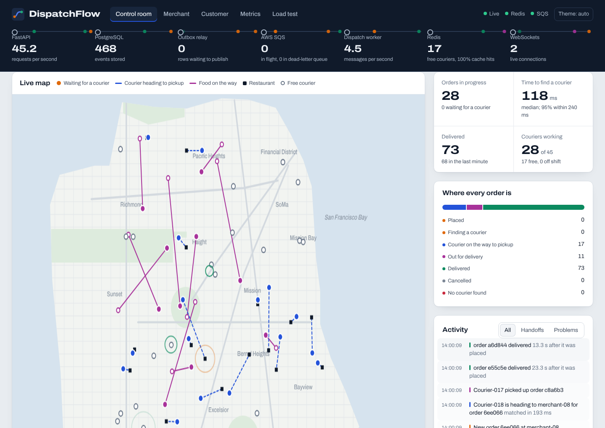
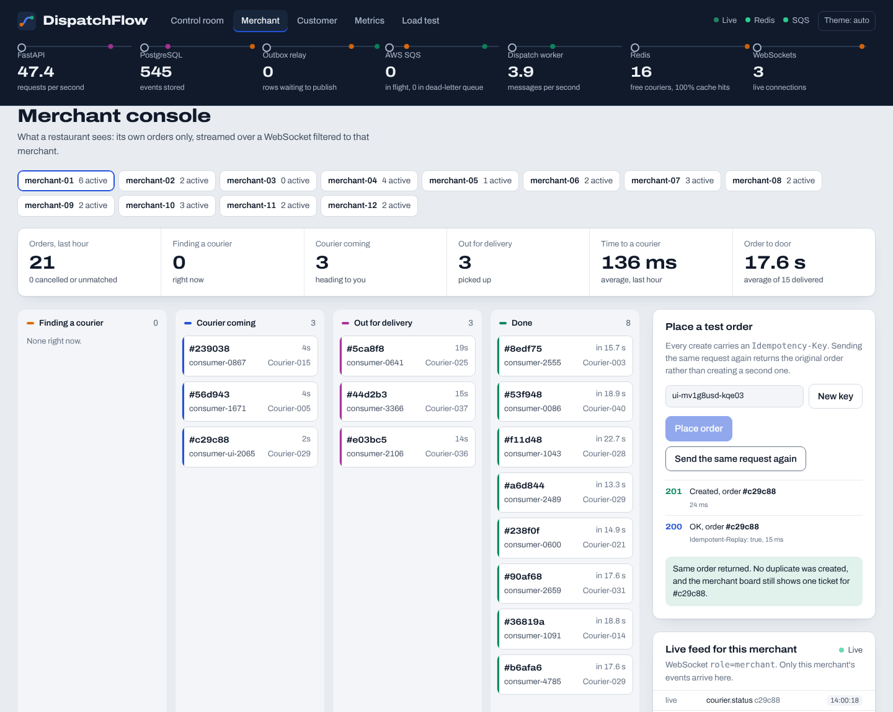
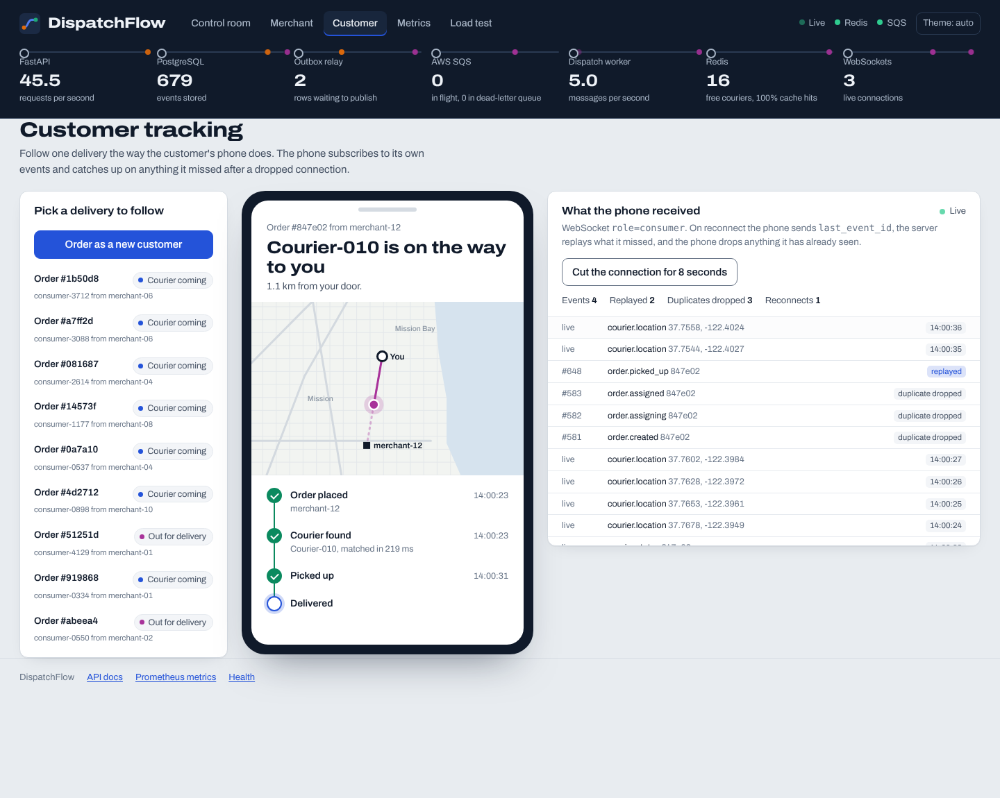
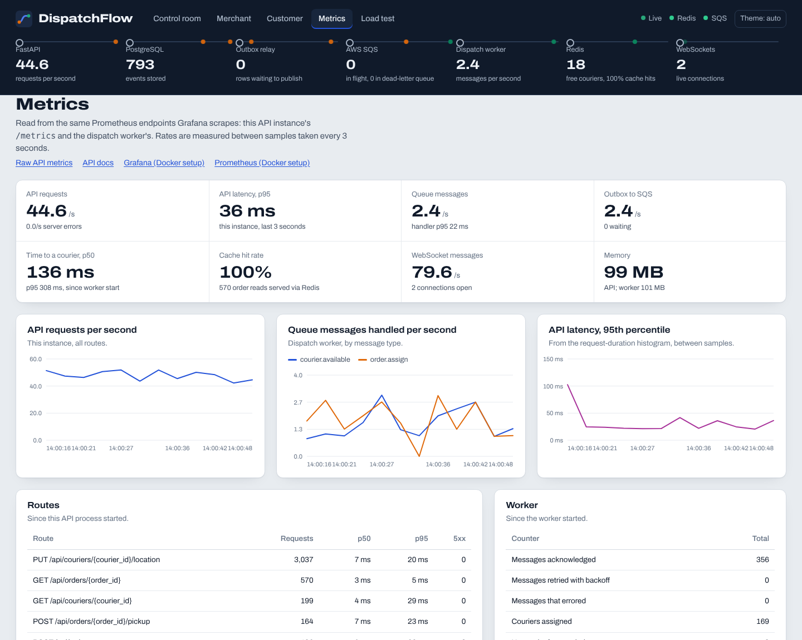
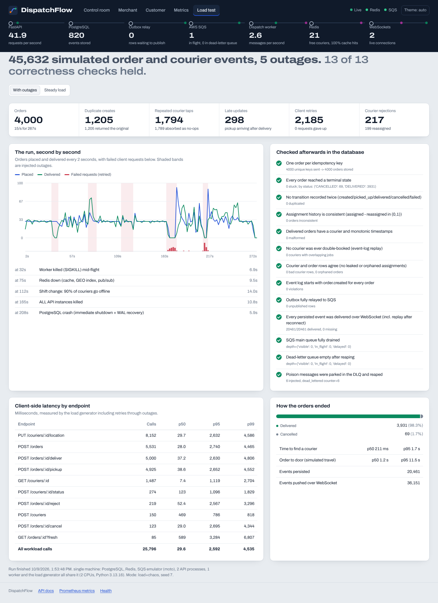

# DispatchFlow

A real-time delivery dispatch platform. It matches orders with available couriers, tracks every delivery through its lifecycle, and streams live order updates to consumers and merchants over WebSockets.

**Python · FastAPI · PostgreSQL · Redis · AWS SQS · WebSockets · Docker**



| Merchant console | Customer tracking |
|---|---|
|  |  |
| **Metrics** | **Load test** |
|  |  |

---

## How each part of the description is implemented

| Description | Where it lives |
|---|---|
| **Matches orders with available couriers** | `app/dispatch.py`. Nearest free courier via a Redis GEO search, then a SQL "queue pop" (`ORDER BY distance LIMIT 1 FOR UPDATE SKIP LOCKED`) so concurrent orders can never grab the same courier. Falls back to pure SQL when Redis is down. Retries with backoff when nobody is free, reassigns on rejection, reclaims assignments a courier never picks up. |
| **Tracks delivery status** | `app/domain.py` state machine: `CREATED → ASSIGNING → ASSIGNED → PICKED_UP → DELIVERED`, plus `CANCELLED` / `FAILED`. Every change is an append-only row in `order_events`. |
| **Streams live order updates to consumers and merchants** | `app/hub.py` + `/ws`. Roles `ops`, `merchant`, `consumer`, `order`, `courier`, each filtered server-side. Reconnect with `last_event_id` to replay anything missed. The UI's **Merchant** and **Customer** views are real clients of these streams. |
| **FastAPI services** | `app/api/routes.py`: orders, courier actions (pickup / deliver / reject), couriers and GPS, events, stats, metrics, WebSocket. OpenAPI docs at `/docs`. Separate `app/worker.py` process for asynchronous work. |
| **PostgreSQL order and courier models** | `app/models.py`: `orders`, `couriers`, `order_events`, `outbox`, with partial and composite indexes. PostgreSQL is the source of truth. |
| **Redis caching** | `app/redis_store.py`. Read-through order cache with version compare-and-set in Lua (a stale write can never overwrite newer data), GEO index of free couriers, pub/sub fan-out to WebSocket servers, shared counters. A circuit breaker degrades to PostgreSQL when Redis is down. |
| **SQS-based asynchronous workflows** | Transactional outbox (`app/outbox.py`) → SQS → worker (`app/worker.py`). Main queue + dead-letter queue, visibility-timeout backoff, poison messages go straight to the DLQ, and a reconciler re-queues any order that lost its message. |
| **WebSocket updates** | Redis pub/sub listener with a PostgreSQL tailer as fallback, de-duplication by event id, slow-consumer protection. |
| **Idempotent APIs for reliable state transitions** | `Idempotency-Key` on create (`INSERT … ON CONFLICT DO NOTHING`; replays return `200` + `Idempotent-Replay: true`). Transitions run under `SELECT … FOR UPDATE` and are classified as apply / duplicate no-op / stale / illegal. Late or out-of-order updates (a pickup arriving after the delivery, an old GPS ping) are absorbed safely. |
| **Load-tested 10K+ simulated order and courier events** | `loadtest/`. Latest runs: **45,632 events** (with outages) and **28,880 events** (steady), with duplicate requests, rejections, delayed updates, retries and five injected service interruptions, then 13 correctness checks against the database. Results below. |
| **Docker** | `Dockerfile` and `docker-compose.yml` (PostgreSQL, Redis, LocalStack SQS, API, worker, Prometheus, Grafana, optional demo traffic). |

## Architecture

```
 merchant / customer / courier apps
        │ HTTP (idempotent)                 ▲ WebSocket (filtered per merchant / customer, replay on reconnect)
        ▼                                   │
   FastAPI ──one transaction──▶ PostgreSQL  │   orders + order_events + outbox row
        │                         │         │
        │                   outbox relay    │
        │                         ▼         │
        │                      AWS SQS ──▶ dispatch worker ──▶ PostgreSQL (assign, retry, timeout, fail)
        │                         └─▶ DLQ   │
        └──── Redis: order cache · GEO index of free couriers · pub/sub ──┘
```

The header of the dashboard is this diagram, live: requests per second, events stored, outbox backlog, SQS messages in flight, worker throughput, couriers in the GEO index and open WebSockets. A dot runs down it for every business event.

## Run it

### Docker (everything, including Grafana)
```bash
make up        # postgres, redis, localstack (SQS), api, worker, prometheus, grafana
make demo      # optional: 45 simulated couriers and a steady stream of orders
```
- Dashboard: http://localhost:8000
- API docs: http://localhost:8000/docs
- Grafana: http://localhost:3000 (admin / admin), with a provisioned 14-panel dashboard
- Prometheus: http://localhost:9090

### Without Docker
Needs `postgresql` and `redis-server` installed. SQS is emulated locally with moto.
```bash
pip install -r requirements-dev.txt
make local         # starts PostgreSQL, Redis, SQS emulator, worker and two API instances
make local-demo    # simulated couriers and orders (Ctrl-C to stop)
make test          # 51 tests
```

## The dashboard

| View | What it shows |
|---|---|
| **Control room** | Live map of couriers and active orders (dashed: courier heading to pickup; solid: food on the way), KPIs, order pipeline, activity feed, throughput, the time-to-courier histogram, and everything the system absorbed (duplicates, late updates, retries, reassignments, dead letters). |
| **Merchant** | One restaurant's orders as a live board, fed by `role=merchant`. **Place a test order** sends a create, then the identical request again with the same `Idempotency-Key`, and shows `201` then `200 Idempotent-Replay` with the same order id. |
| **Customer** | A phone screen tracking one delivery from `role=consumer&last_event_id=0`, with the courier moving on a mini-map. **Cut the connection for 8 seconds** drops the socket; on reconnect the missed events arrive marked *replayed* and overlapping ones are counted as *duplicates dropped*. |
| **Metrics** | Parsed from the API's and the worker's Prometheus endpoints: request rate, p95 latency, queue messages per second by type, outbox throughput, time to a courier, cache hit rate, WebSocket messages, memory, and per-route and worker counters. |
| **Load test** | The latest report: run timeline with outage bands, the 13 database checks, client latency per endpoint, and how orders ended. |

Light and dark themes, works down to phone width, respects reduced motion. The font (Archivo, OFL) is self-hosted, so the page needs no internet access.

## Load and reliability tests

```bash
make loadtest-steady   # 2,500 orders at 15/s, no outages
make loadtest          # 4,000 orders at 15/s with five outages
```

Each run mixes in duplicate creates (15% of orders retried 1–3 times), repeated courier taps, pickups delayed until after delivery, courier rejections, cancellations and malformed SQS messages. The outage run also kills the worker with SIGKILL, takes Redis down, sends 90% of couriers off shift, kills every API instance and crashes PostgreSQL. After draining, `loadtest/verify.py` checks the database:

one order per idempotency key · every order terminal · no transition recorded twice · consistent assignment history · delivered orders well-formed · no courier double-booked · courier and order rows agree · every event log starts with `order.created` · outbox fully relayed · every persisted event delivered over WebSocket · SQS drained · DLQ drained · poison messages dead-lettered.

**Latest results** (`loadtest/results/latest-*.md`):

| | Steady load | With 5 outages |
|---|---|---|
| Orders | 2,500 | 4,000 |
| Total simulated order and courier events | **28,880** | **45,632** |
| Duplicate create requests | 768 | 1,205 |
| Delivered / cancelled / failed | 2,474 / 26 / 0 | 3,931 / 69 / 0 |
| Time to find a courier, p50 / p95 | 0.17 s / 0.30 s | 0.21 s / 1.70 s |
| API latency, all workload calls, p50 / p95 | 9.7 ms / 26.7 ms | 29.6 ms / 2.6 s (retries through outages) |
| Correctness checks | 13 / 13 | 13 / 13 |

These ran on one 2-CPU machine shared by PostgreSQL, Redis, the SQS emulator, two API processes, the worker and the load generator, at about 15 orders/s (≈95 requests/s). They show correctness under failure, not production capacity. How many orders fail during the 90%-off-shift outage depends on timing: earlier runs closed 33 and 147 orders as "no courier found" after all retries, and this one closed none.

## AWS

**For testing, only SQS needs to be on AWS.** Fill in `.env.aws` (from `.env.aws.example`) and run `make aws-up`: the worker uses your real SQS queues, everything else stays in Docker on your laptop. Step-by-step instructions are in the Quick start of [`docs/AWS_SETUP.md`](docs/AWS_SETUP.md), which also covers:
- **Path A:** the same without Docker (`infra/aws/create_sqs.sh` + AWS CLI).
- **Path B:** a full deployment on RDS PostgreSQL, ElastiCache Redis, SQS with a DLQ, ECS Fargate (API + worker) and an ALB, with IAM policies, alarms and teardown.

`python scripts/aws_check.py` checks PostgreSQL, Redis and SQS (queues, redrive policy, visibility timeout, round trip) and prints a fix for anything wrong. It passes against the local stack. The AWS steps have not been run against a live account. Credentials come from `AWS_PROFILE` or the ECS task role, never from code.

## Layout

```
app/            FastAPI app, worker, domain, models, Redis store, SQS client, WebSocket hub, metrics
app/static/     the dashboard (single HTML file) and its font
loadtest/       simulator, chaos timeline, invariant checks, results
tests/          51 tests: domain, orders, SQS pipeline, HTTP and WebSocket
scripts/        stackctl.py (local stack without Docker), aws_check.py
infra/aws/      SQS script, IAM policies, ECS task definition
monitoring/     Prometheus config, Grafana provisioning and dashboard
docs/           AWS guide, screenshots
```
